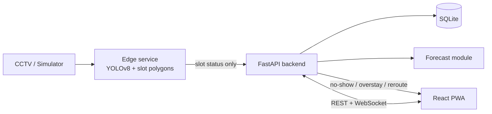
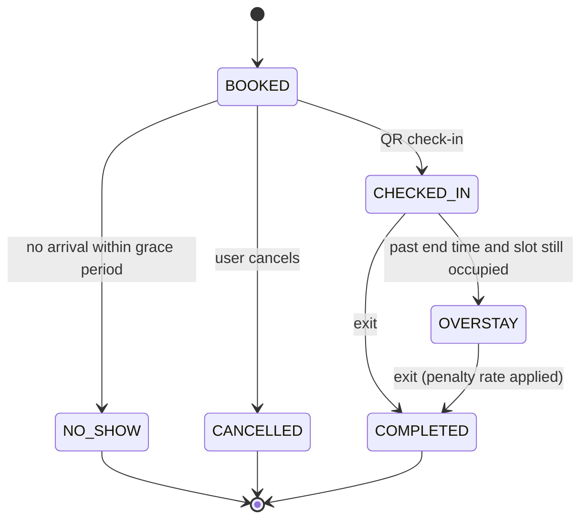

# ParkSetu: Smart Parking Management

A hyperlocal smart parking web app (PWA) that helps drivers find, book and reach a parking slot in private lots such as malls and petrol pumps. It uses existing CCTV cameras and computer vision to know which slots are really free, and handles no-shows and overstays automatically.

Built for the **Urban System** theme (Semester 5, T.Y. B.Tech Information Technology) with Mira Bhayandar as the pilot area.

> **Pitch:** Use the CCTV cameras lots already have, with no new sensors, to give drivers live, reliable parking availability.

<!-- Add screenshots here -->
<!--   -->

---

## Table of contents
- [Why ParkSetu](#why-parksetu)
- [Features](#features)
- [How it works](#how-it-works)
- [Tech stack](#tech-stack)
- [Repository structure](#repository-structure)
- [Getting started](#getting-started)
- [Demo accounts](#demo-accounts)
- [Demo scenarios](#demo-scenarios)
- [API overview](#api-overview)
- [Computer vision and forecasting](#computer-vision-and-forecasting)
- [Deployment](#deployment)
- [Privacy](#privacy)
- [Limitations](#limitations)
- [Roadmap](#roadmap)
- [Related research](#related-research)
- [Team](#team)

---

## Why ParkSetu
Drivers in dense areas waste time and fuel circling for parking, while private lots have unused capacity that nobody can see. Many existing systems detect free slots or take bookings. ParkSetu focuses on the part that usually breaks in practice: **what happens when users don't show up or stay too long.**

Related UN SDGs: **11** (Sustainable Cities and Communities), **13** (Climate Action), **9** (Industry, Innovation and Infrastructure).

## Features

**For drivers**
- Find nearby lots using live location, with distance, price and free-slot count
- Book a slot for a start and end time and get a QR code for check-in
- Live slot grid for each lot
- Reminders before the booking ends, with one-tap extend
- Instant reroute suggestions when the booked slot is at risk
- Forecast of when a full lot will have a free spot

**For lot owners**
- Register a lot and define its slots (including buffer slots that can't be booked)
- Live occupancy view

**For the city / admin**
- Occupancy by hour, peak hours, no-show rate, overstay rate and revenue

**System**
- Camera-based slot detection (YOLOv8) with a simulator for demos without a camera
- Automatic no-show release and overstay detection
- Grace periods and a higher overstay rate
- Installable PWA

## How it works



**Booking lifecycle**



**Key rules**
- Buffer slots are never bookable, so one overstay doesn't cascade into failed bookings.
- A slot is bookable for a window only if no active booking overlaps it.
- If a lot is full, the API returns alternatives nearby.
- If the previous booking on a slot is running late, the next booking is marked **at risk** and the driver is offered another lot before arriving.
- `amount = ceil(hours booked) * price_per_hour + (overstay_minutes / 60) * price_per_hour * overstay_multiplier`

## Tech stack

| Layer | Technology |
|---|---|
| Frontend | React 18, Vite, TypeScript, Tailwind CSS, React Router, TanStack Query, Leaflet (OpenStreetMap), Recharts, `vite-plugin-pwa` |
| Backend | Python, FastAPI, SQLAlchemy, SQLite, Pydantic, JWT auth, APScheduler, WebSockets |
| Vision | YOLOv8 (Ultralytics), OpenCV, Shapely |
| Forecast | scikit-learn |

## Repository structure

```
parksetu/
  backend/    # FastAPI API, database models, scheduler jobs
  frontend/   # React PWA
  ml/
    vision/   # slot detector, edge service, simulator, calibration tool
    forecast/ # dwell-time model and next-free prediction
    eval/     # detector evaluation scripts
    tools/    # mock backend for testing
  docs/       # project spec and build notes
```

## Getting started

### Prerequisites
- Python 3.11+
- Node.js 18+
- Git

### 1. Clone
```bash
git clone https://github.com/<your-username>/parksetu.git
cd parksetu
```

### 2. Backend
```bash
pip install -r backend/requirements.txt
cd backend
python seed.py            # creates demo users, 3 lots and their slots
cd ..
export PYTHONPATH=.       # Windows PowerShell: $env:PYTHONPATH="."
uvicorn backend.app.main:app --reload --port 8000
```
API docs: http://localhost:8000/docs

### 3. Frontend
```bash
cd frontend
cp .env.example .env      # set VITE_USE_MOCK=false and VITE_API_URL=http://localhost:8000
npm install
npm run dev
```
App: http://localhost:5173

> Set `VITE_USE_MOCK=true` to run the frontend on built-in fake data without the backend.

### 4. Slot status feed

**Without a camera (simulator):**
```bash
pip install -r ml/requirements.txt
cd ml
python -m vision.simulator --lot-id 1 --slots <slot ids from GET /lots/1/slots> --interval 3
```
Use `--scenario overstay` to keep one slot occupied so the overstay flow can be demonstrated.

**With a video or camera:**
```bash
python -m vision.calibrate --image frame.jpg --lot-id 1    # mark slot polygons once
python -m vision.edge_service                              # reads SOURCE from vision/config.py
```

### Environment variables

| Variable | Where | Purpose |
|---|---|---|
| `JWT_SECRET` | backend | Signs login tokens |
| `EDGE_API_KEY` | backend + edge service | Authenticates the camera service (default `dev-edge-key`, change it in production) |
| `DEMO_MODE` | backend | `true`: grace 2 min, reminder 3 min before end, 15 s ticks. `false`: grace 15 min, reminder 15 min, 60 s ticks |
| `DATABASE_URL` | backend | Optional, defaults to local SQLite |
| `CORS_ORIGINS` | backend | Allowed frontend origins |
| `VITE_API_URL` | frontend | Backend URL |
| `VITE_USE_MOCK` | frontend | `true` to use mock data |
| `BACKEND_URL`, `LOT_ID`, `SOURCE` | edge service | Where to post, which lot, which video source |

## Demo accounts

Created by `seed.py` for local testing only. Change or remove them before any public deployment.

| Role | Email | Password |
|---|---|---|
| Driver | `driver@demo.com` | `demo1234` |
| Owner | `owner@demo.com` | `demo1234` |
| Admin | `admin@demo.com` | `demo1234` |

## Demo scenarios

1. **Live availability:** run the simulator and watch the slot grid update on a lot page.
2. **Book and check in:** book a slot, open `/gate`, paste the QR token, and the booking becomes `CHECKED_IN`.
3. **No-show:** book a slot and don't check in. With `DEMO_MODE=true` it is released after about 2 minutes.
4. **Overstay:** keep a checked-in slot occupied past its end time (simulator `--scenario overstay`). The booking becomes `OVERSTAY` and the penalty accrues.
5. **Reroute:** book the same slot right after the overstaying booking. It is marked at risk and the driver sees nearby alternatives.
6. **Full lot:** book every slot, then try one more. The API responds with alternatives.

## API overview

Full interactive docs are at `/docs` when the backend is running.

| Area | Endpoints |
|---|---|
| Auth | `POST /auth/register`, `POST /auth/login` |
| Lots | `GET /lots/nearby`, `GET /lots/{id}`, `GET /lots/{id}/slots`, `POST /lots`, `POST /lots/{id}/slots`, `GET /lots/{id}/forecast` |
| Bookings | `POST /bookings`, `GET /bookings/me`, `POST /bookings/{id}/extend`, `/cancel`, `/exit`, `GET /bookings/{id}/alternatives` |
| Check-in | `POST /checkin` |
| Camera feed | `POST /vision/slot-status` (header `X-Edge-Key`) |
| Admin | `GET /admin/stats` |
| Realtime | `WS /ws/lots/{lot_id}`, `WS /ws/me?token=` |

Timestamps are ISO 8601 in UTC; the app displays them in IST.

## Computer vision and forecasting

**Slot detection**
- YOLOv8 detects vehicles (car, motorcycle, bus, truck) in sampled frames.
- A slot is occupied if a vehicle overlaps its polygon beyond a configurable threshold.
- Majority voting over the last few frames removes flicker.
- Optional contrast enhancement for low-light footage.
- Only slot statuses are sent to the server, never video or images.

**Free-up forecast**
- Baseline: the earliest booked end time among occupied slots.
- Improved: combines booked end times with a learned dwell-time estimate for walk-ins.

**Evaluation**
- `ml/eval/evaluate_detector.py` reports precision, recall and F1 per lighting condition (day, dusk, night).
- `ml/forecast/train_dwell.py` reports forecast error in minutes against a baseline.

Results: _to be added after testing on recorded lot footage._

## Deployment

The web app (frontend and backend) can be hosted in the cloud, for example the frontend on Vercel and the backend on Render. The camera/edge service runs on a computer at the lot and posts slot statuses to the cloud backend.

- Set `VITE_API_URL` to the deployed backend and add the frontend URL to `CORS_ORIGINS`.
- Use strong values for `JWT_SECRET` and `EDGE_API_KEY`.
- Free hosting tiers may put the backend to sleep when idle and may not keep SQLite data between deploys. For anything beyond a demo, use a hosted database and an always-on service.
- Browsers only allow geolocation and PWA install over HTTPS.

## Privacy
- Video stays at the lot. The edge service uploads only `{slot_id, occupied, confidence}`.
- Vehicle numbers are used only to tie a booking to a driver. Retention and deletion rules should be defined before any real deployment.

## Limitations
- Tested with a simulator and recorded or toy-scale footage, not at a live commercial lot.
- Check-in uses QR tokens; automatic number plate recognition is not implemented yet.
- Payments are not integrated. The backend calculates amounts only.
- Detection accuracy depends on camera angle, lighting and correct slot polygons.
- Default demo timings are shortened and should be changed for real use.

## Roadmap
- [ ] Automatic number plate recognition for check-in and exit
- [ ] Payment integration
- [ ] Multi-lot rerouting optimization
- [ ] PostgreSQL, a separate worker for timers, and Redis for live state
- [ ] Night and low-light fine-tuning on local footage
- [ ] Multilingual interface (Hindi, Marathi)
- [ ] Pilot at a real lot in Mira Bhayandar

## Related research
- SmartPark AI (IRJET): YOLO-based slot detection from CCTV with booking
- Camera-based parking reservation system (DLSU Senior High School Research Congress, 2025)
- YOLOv8 parking space detection on the PKLot dataset
- BRAC University thesis on free-slot detection using only existing CCTV footage

ParkSetu extends this line of work with booking-to-vehicle binding, a full no-show and overstay lifecycle, proactive rerouting, and free-up time prediction.

## Team
**Code Forge**, Shree L.R. Tiwari College of Engineering, Mumbai.

## License
Add a license file (for example MIT) before publishing, or state "All rights reserved" if the project should not be reused.
